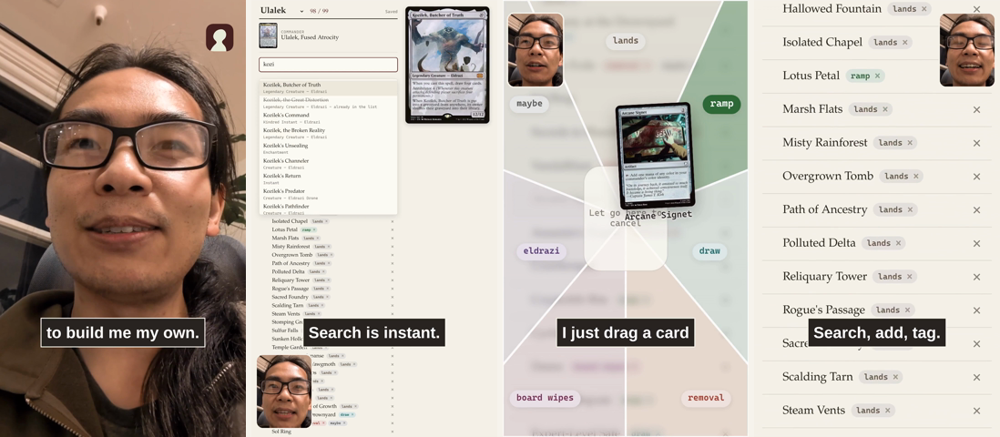

# Magic Deckbuilder

An Imbue Studio template. To install it on a workspace, ask your agent: "Install the Magic Deckbuilder from
https://github.com/boweiliu/magic-deckbuilder" (it follows `skills/import-magic-deckbuilder/SKILL.md`). MIT licensed.

[](docs/deck-list-reel.mp4)

[Watch the 30-second reel](docs/deck-list-reel.mp4) (sound on).

**Deck List** is a place to write down a Magic: The Gathering Commander deck, card by card. Type a few letters and
every card ever printed comes up instantly, with its picture, because the whole of Scryfall is copied onto your
workspace. Then tag cards by picking one up and dragging it toward a category: the screen splits into zones (ramp,
draw, board wipes, whatever you set up) and dropping the card on one adds that tag. Search, add and tag all happen on
one screen.

It started as two prompts in Studio: copy all of Scryfall with its community tags, then "a place to write down card
names and have them autocomplete". Everything else came from using it on a real deck and asking for the next thing.

## What it does

- **Autocomplete over every card**, from a local copy of Scryfall (cards, rulings and the community
  [Tagger](https://tagger.scryfall.com) tags), refreshed every day. Card pictures load straight from Scryfall.
- **Categories as chips**, and **drag-to-tag**: hold a card, drag it toward a category's zone, let go. A card can be
  in any number of categories. The categories page sets their names, colours and where their zones sit.
- **Auto-tag**: suggests tags (lands by type; ramp, draw, interaction, wipes and tutors by Tagger tags) for you to
  review. It only adds, never removes or repeats a tag.
- **Several lists** (a pool and the real 99, say), a **grouped view** that adds a whole cycle at once (all ten
  Landscapes, all five snow basics) and keeps it together, and a count toward 99.
- **Phone layout**: it is made to be used from a phone through the workspace's sharing link.
- **Plain text decks**: each list is a `.txt` file in the format Moxfield and Archidekt import.
  If you make the decks folder a git repo with an `origin`, every change is committed and pushed in the background.

### Child apps

Two smaller apps live under `child-apps/` and read the same card data and deck lists. They are optional.

- **Goldfish** (`child-apps/goldfish/`): play a Deck List deck solo to see how its draws and first turns go, on a
  laptop or a phone, with card previews you can actually read.
- **AI Card Search** (`child-apps/card_search/`): you work out a hard card search with your agent in chat (say, "every
  permanent with a free activated ability that draws cards"); the agent writes it as SQL over the card data and this
  app shows the matching cards with the matching rules text highlighted. You can edit and re-run each search.

## How it works

| Part | Where |
| --- | --- |
| Scryfall download and card database | `scryfall_mirror/` (`scryfall-mirror refresh`, run daily by a routine) |
| Deck List server, decks, tags, groups, auto-tag | `deck_list/src/deck_list/` |
| Deck List page (search, chips, drag-to-tag zones) | `deck_list/src/deck_list/static/` |
| Goldfish | `child-apps/goldfish/` |
| AI Card Search | `child-apps/card_search/` |
| Workspace wiring (programs, the daily routine) | `workspace/supervisord/`, `workspace/routines/` |

Each app is a small Flask server with a static page. The card database is SQLite at
`data/.apps/deckbuilder/scryfall/scryfall.db`; the first download and load take a while and need about 3 GB of disk.
Decks live in `data/.apps/deck-list/decks/`.

## Known gaps

- A new workspace starts with one list, `ulalek`, with Ulalek, Fused Atrocity as its commander. The page has no button
  to set a commander yet: ask your agent to change it (the add endpoint takes `"as_commander": true`), or edit the
  `// Commander` line in the deck's `.txt` file. "New list" can copy the current commander.
- The apps rely on Studio workspace libraries (`system/libs/`), so they run inside a Studio workspace, not on their own.

## Install, run, test

`skills/import-magic-deckbuilder/SKILL.md` has the install steps. Tests, from each app's folder:

```bash
uv run --frozen pytest -q
```

The deck tests that need real card data skip when the card database is not there yet.
